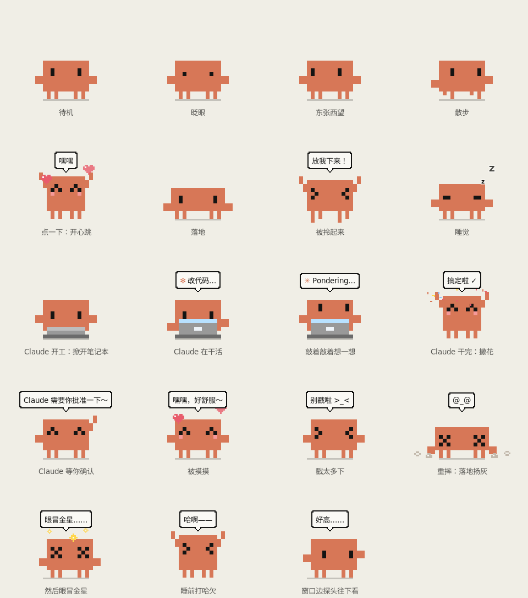

# Clawd 桌宠

一只住在桌面底边的小 Clawd：像素风、会散步、会睡觉、会被你拎起来扔出去，
还能和 Claude Code 联动，Claude 干活时它在旁边敲键盘，干完了跳起来告诉你。



## 启动

```bash
python3 clawd.py
```

只用系统自带的 Python 3 + GTK3（PyGObject），不用装别的东西。
重复启动不会出第二只，已经在跑的那只会冒一句"我在这儿呢！"。

## 怎么玩

| 操作 | Clawd 的反应 |
| --- | --- |
| 左键点一下 | 开心地跳一下，冒小爱心 |
| 按住拖动 | 被拎起来，腿在空中乱蹬 |
| 拖着甩出去再松手 | 按甩的速度飞出去，撞墙会弹；横着甩的话落地后脚底刹着往前滑一段，滑出窗口边就掉下去；落地扬起一团灰，摔得重会弹一下；摔得特别重的话一砸下去眼睛就变成 × ×、头上绕着星星，像皮球一样一下比一下矮地弹几下，再晕一会儿；晕着把它拎起来、放下，它也还是晕的，到点才缓过来 |
| 鼠标在它身上来回蹭 | 被摸摸，眯眼脸红 |
| 2.5 秒内连戳 5 下 | 生气，原地发抖 |
| 睡着时点它 | 吓醒 |
| 右键 | 菜单：说句话 / 睡觉 / 自由散步 / 在窗口上走 / 安静模式 / 大小 / 重新加载 clawd.py / 退出 |

没人理它的时候，它会自己散步、东张西望、眨眼、偶尔说句话（深夜会催你睡觉，中午问你吃饭没）。
5 分钟没人碰，它就伸长身子打个哈欠，开始打瞌睡；醒来会先伸个懒腰。

## 在窗口上走

装上配套的 GNOME 扩展后，窗口露在外面的上沿都是 Clawd 的地面：

- 把它拖到窗口上方松手，它会落在窗口顶上；扔过去也行
- 它会在窗口顶上散步，偶尔走到边上探头往下看一眼，再一脚踩空跳下去，或者蹲一下蓄力，蹦到别的窗口上
- 你拖动窗口时它跟着走，而且有惯性：
  - 慢慢拖，它稳稳站着
  - 往下猛拉，窗口比它掉得快，它就被甩下来
  - 往上一推再急停，它会被抛到半空
  - 横着拖它抓得住；拖得快的时候突然停下或者掉头，它会被往前甩飞出去，慢慢停下就稳稳站着
- 拿窗口快速扫过它（不管它站在地上、别的窗口上还是在半空），会把它撞飞；慢慢挪过去、最大化不算
- 窗口被关掉、最小化、被别的窗口盖住，它就掉下来
- 最大化的窗口、离屏幕顶太近的窗口不算（头顶放不下它和对话框）

为什么要扩展：Wayland 下普通程序看不到别的窗口在哪，只有 GNOME Shell 知道。
[扩展](gnome-extension/clawd-windows@clawd.pet/extension.js)很小：当前工作区的窗口一有变化（拖动、缩放、最小化、叠放顺序变了），
就赶在这一帧画面画出来之前通过 D-Bus（`org.clawd.Windows`）告诉 Clawd，所以你拖窗口时它能贴着窗口走。
只发位置和大小，不发标题和内容。
扩展还顺带管 Clawd 窗口的鼠标：鼠标不在 Clawd 身上时，让它的窗口不接收鼠标，点击落到后面的窗口。

```bash
./install.sh --windows
```

Wayland 下 GNOME Shell 只在登录时加载新扩展，所以装完要注销重新登录一次。
不想要了就 `gnome-extensions uninstall clawd-windows@clawd.pet`，或者右键菜单里关掉"在窗口上走"。
目前只适配 GNOME 42（Ubuntu 22.04）。

只有 Clawd 的身体能点到，对话框、两边的小手、敲代码时的笔记本和周围的透明区域都让鼠标穿过去，不挡你干活。
GNOME 的 Wayland 会话里这一点要靠下面的 GNOME 扩展：Wayland 下 X11 窗口自己设的点击区域不算数，
没装扩展的话 Clawd 的整个窗口（头顶留给对话框的那块也算）都会挡住鼠标。

## 和 Claude Code 联动

把 [claude-hooks.json](claude-hooks.json) 里的 `hooks` 合并进 `~/.claude/settings.json`（里面写的是 `~/clawd/clawd.py`，放在别处的话改成你的路径），之后：

- 你发消息时：Clawd 掀开一台小笔记本，坐在后面敲键盘，眼睛跟着屏幕上的代码左右移，隔一会儿抬头想一想；头顶转着 `✻ Clauding…`
- Claude 调工具时：头顶换成具体在干嘛（翻代码、改代码、敲命令、上网查……）
- Claude 回复完：笔记本"噗"地收起来，它跳起来撒一把彩纸，说"搞定啦 ✓"
- Claude 需要你批准或在等你回复时：挥手叫你

hook 跑的是 `clawd.py notify …`，不加载 GTK，一次大约 20ms；Clawd 没在运行时它什么都不做，也不会报错。
你也可以自己发消息逗它：

```bash
python3 clawd.py notify say "今天下班早点走"
```

## 加进应用菜单 / 开机自启

```bash
./install.sh
```

```bash
./install.sh --autostart
```

撤销就删掉 `~/.local/share/applications/clawd-pet.desktop` 和 `~/.config/autostart/clawd-pet.desktop`。

## 调手感、改代码

右键 →「调手感」里能直接改这些参数，选了马上生效：

| 菜单里 | 代码里 | 管什么 |
| --- | --- | --- |
| 抓地力 | `GRIP` | 窗口减速时脚底刹得住多少，越大越难被横着甩飞 |
| 急停多快会被甩飞 | `FLING_SPEED` | 急停、掉头时冲出去多快算被甩飞 |
| 往下拉浮起几格就掉 | `LOOSE` | 往下拉窗口时浮起多高算被甩开 |
| 窗口多快会把它撞飞 | `KNOCK_SPEED` | 也可以选「永远不撞」 |
| 落地后刹车多猛 | `SKID_FRICTION` | 横着扔到地上后滑多远，越小滑得越远 |
| 重力 / 跳跃力度 / 走路速度 | `GRAVITY` / `JUMP_SPEED` / `WALK_SPEED` | |

调过的会标 `*`，存在 `~/.config/clawd-pet/config.json` 里，重启后还在；「全部恢复成代码里的值」一键还原。
注意菜单里调过的值会盖住代码里的值，想改代码里的默认值之前先恢复一下。

直接改 `clawd.py` 的话，保存后右键 →「重新加载 clawd.py」，
或者运行 `python3 clawd.py notify reload`，Clawd 就换成新代码，不用重新登录。

- 新代码有语法错误：不换，气泡里告诉你第几行
- 新代码一启动就崩：旧的 Clawd 会回来，报错在 `~/.cache/clawd-pet/clawd.log`

只有改了 `gnome-extension/` 里的扩展才需要注销重新登录。

## 其他

- 设置（大小、散步、安静模式）存在 `~/.config/clawd-pet/config.json`
- `python3 clawd.py --preview preview.png` 把所有动作渲染成上面那张图
- GNOME 的 Wayland 不允许窗口自己定位和置顶，所以 Clawd 跑在 XWayland 上（脚本里自动设了 `GDK_BACKEND=x11`）。
  因为是悬浮窗，全屏看视频时它也会在最上面，可以右键让它睡觉或者退出。

## 许可证

[MIT](LICENSE)
